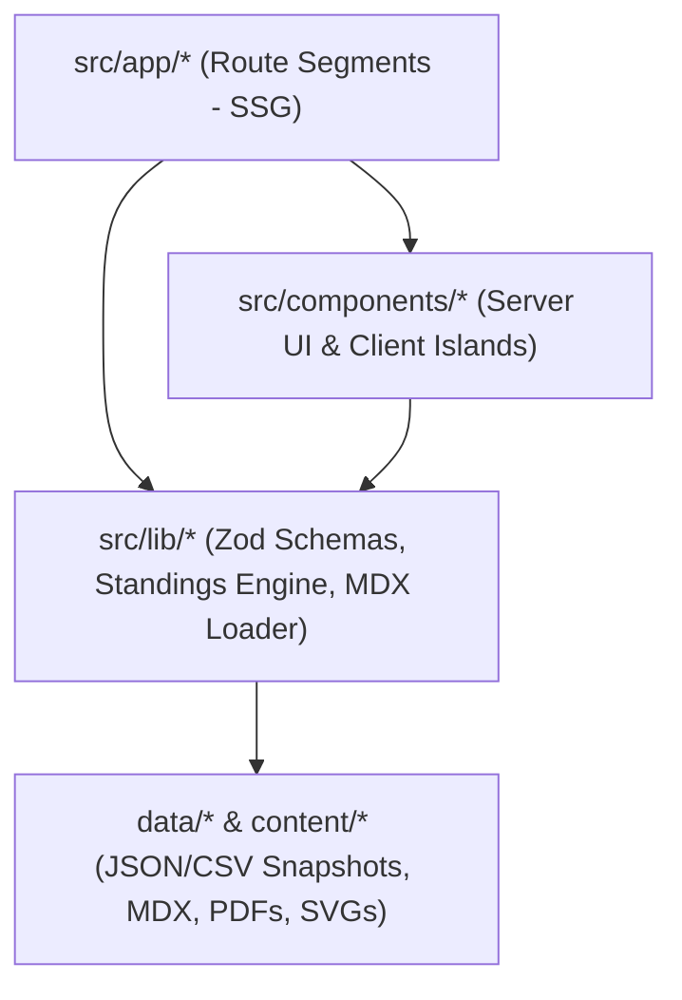
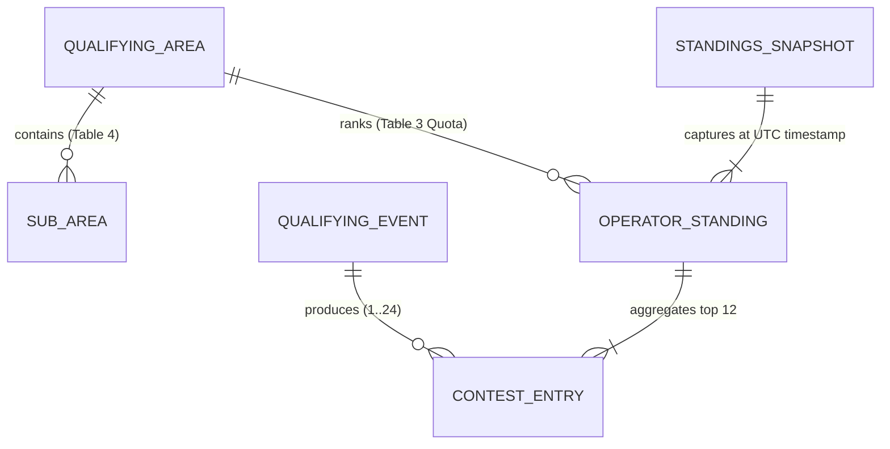

# Architecture Spine — WRTC 2030 Croatia Official Web Platform

## Design Paradigm

**Static-First Layered App Router (`Next.js 15 App Router` + Build-Time Validated Content/Data Layer + Client-Side Interactive Standings Island).**

The system separates responsibilities into four strict vertical layers with unidirectional dependencies:
1. **`content/` & `data/` (Source-of-Truth Assets):** Versioned Markdown/MDX files for news and rules (`Selection Rules v1.0`, `Q&A`, `Score Calculation Examples`), JSON/CSV snapshots for **Qualification Standings** (`29 QAs`, `24 Qualifying Events`), and static metadata (`Organizing Committee`, `Past Events`, `Sponsors`).
2. **`src/lib/` (Domain & Schema Validation Layer):** Pure TypeScript modules and `Zod` schemas that parse, validate, normalize, and index standings snapshots, QA quotas, and MDX content at build time.
3. **`src/components/` (Design System & Interactive Islands):** Presentational Server Components (`CheckerMark`, `CheckerFive`, `CheckerStrip`, `WrtcLogo`, `SponsorTierGrid`, `RulesTable`) and isolated Client Components (`StandingsExplorer`, `OperatorBreakdownDrawer`, `ThemeToggle`).
4. **`src/app/` (Next.js App Router Pages & Routes):** Statically generated (`SSG`) route segments serving pre-rendered HTML and RSC payloads from CDN edge nodes.



## Invariants & Rules

### AD-1 — Official `wrtc2030.hr` Brand Tokens, SVG Logos & `.checker` Primitives [ADOPTED]

- **Binds:** `FR-1`, `FR-2`, `NFR-2`
- **Prevents:** Uncoordinated CSS overrides, placeholder/invented logos ("fake red cross logo"), or inconsistent red checker motifs across feature pages.
- **Rule:** All pages and components must use the canonical `WrtcLogo` component rendering `/brand/wrtc-logo.svg` in `day` mode and `/brand/wrtc-logo-white.svg` in `night` mode, paired with CSS custom properties mapped to `data-theme="day" | "night"` (`#273B8F` Royal Blue, `#ED1C24` Checker Red, `#0D1333` Shack Navy, `#D99B26` Slavonian Gold) and the three shared checker primitives (`<CheckerMark />` for 2x2 diagonal kickers, `<CheckerFive />` for the 5-square stepped callout mark matching the SVG logo, and `<CheckerStrip />` for structural section dividers).

### AD-2 — Zero-FOUC Dual-Theme Architecture (`data-theme="day" | "night"`) [ADOPTED]

- **Binds:** `FR-1`, `NFR-2`, `NFR-3`
- **Prevents:** Flash of unstyled content (white flash in a dark radio shack), hydration mismatches between server and client, or diverging Tailwind dark-mode selectors.
- **Rule:** Root `<html>` carries `data-theme="day"` or `data-theme="night"` initialized by a synchronous inline `<script>` in `src/app/layout.tsx` reading `localStorage.getItem('wrtc2030-theme')` (falling back to `prefers-color-scheme`). All theme-aware colors are referenced via semantic CSS variables (`--bg`, `--surface`, `--text`, `--navy`, `--red`, `--gold`, `--border`), and both logo variants (`logo--day` / `logo--night`) are toggled purely via CSS `[data-theme="night"]` rules so server HTML is theme-agnostic.

### AD-3 — Build-Time Schema Validation for Standings Snapshots

- **Binds:** `FR-3`, `FR-4`, `FR-6`, `FR-12`, `NFR-1`
- **Prevents:** Broken leaderboards, invalid Qualifying Area codes, or runtime crashes when a new contest standings CSV/JSON is uploaded after one of the 24 Qualifying Events.
- **Rule:** Every standings snapshot in `data/standings/*.json` (or converted from CSV via `scripts/import-standings.ts`) must pass `StandingsSnapshotSchema` (`Zod`) during `next build` and CI. The schema enforces: (a) valid QA codes matching Table 3 (`29 QAs`, `50 Qualifying Teams` total allocation), (b) valid event IDs (`1..24` matching Table 1), (c) at most 12 counted events per operator (`counted: true`), and (d) monotonic rank sorting per QA with deterministic tie-breaking. No component may read raw unvalidated JSON/CSV directly.

### AD-4 — Static Edge Pre-Rendering with Client-Side Standings Indexing

- **Binds:** `FR-3`, `FR-4`, `NFR-1`, `NFR-3`
- **Prevents:** Database hosting costs, backend query latency bottlenecks during post-contest traffic spikes, or sluggish client-side filtering across 3,500+ callsigns.
- **Rule:** All public routes compile as static pages (`export const dynamic = 'error'`). `/competition/standings/` pre-renders the initial Quota & Leaderboard shell at build time and hydrates the `<StandingsExplorer />` Client Component with a pre-indexed, gzipped JSON payload (`< 250 KB`). QA filtering, Sub-Area filtering, callsign prefix search, and the `<OperatorBreakdownDrawer />` execute entirely in memory in `< 50ms` while syncing state to URL search params (`?qa=EU-2&call=9A5W`) via `nuqs` / `useSearchParams`.

### AD-5 — Single-Source Selection Rules & Structured Tables (`Tables 1–7`)

- **Binds:** `FR-5`, `FR-6`
- **Prevents:** Drift between the Selection Rules v1.0 tables (`Table 1: 24 Qualifying Events`, `Table 2: Weighting Factors`, `Table 3: 29 QAs & 50 Slots`, `Table 4: Sub-Areas`, `Table 5: Category Order`, `Table 6: QA Changes`, `Table 7: Special Teams`) and the interactive Standings / Calendar pages.
- **Rule:** The canonical machine-readable definitions for the 24 Qualifying Events (`data/rules/qualifying-events.json`), 29 Qualifying Areas & Quotas (`data/rules/qualifying-areas.json`), and Weighting Factors (`data/rules/weighting-factors.json`) are the single source of truth imported by **both** the `/competition/selection-rules/` table renderers and the `/competition/standings/` and `/competition/qualifying-events/` engines.

### AD-6 — Strictly Non-Transactional Sponsorship & Static Tier Recognition [ADOPTED]

- **Binds:** `FR-10`
- **Prevents:** Unrequested interactive 60-tent picking grids, live crowdfunding progress bars, or premature online bidding auctions that misrepresent WRTC OC processes.
- **Rule:** `/sponsors/` and the homepage sponsor strip are strictly static, non-transactional Server Components driven by `data/sponsors.json` (grouped into `Institutional Host`, `Corporate & Equipment Tiers`, `Club Sponsors`, and `Individual Donors`) paired with direct `mailto:wrtc2030@hamradio.hr` partnership inquiry links. No payment gateways, crowdfunding meters, bidding widgets, or interactive tent-reservation grids may be introduced.

### AD-7 — Grounded Serverless AI Concierge (`/api/chat` + Local Knowledge Bundle) [ADOPTED]

- **Binds:** `FR-13`, `NFR-3`
- **Prevents:** Hallucinated contest rules, ungrounded tourism answers, or exposed LLM API keys in client bundles.
- **Rule:** The on-page AI Assistant (`<WrtcAiAssistant />`) communicates exclusively with a server-side Next.js Route Handler (`src/app/api/chat/route.ts`, deployed as a Netlify Serverless Function) that injects a build-time-compiled knowledge bundle (`data/knowledge/wrtc2030-and-slavonia-kb.json` combining Selection Rules v1.0, Q&A, 24 Qualifying Events, 29 QA quotas, and curated Croatia & Slavonia accommodation, food, and tourism guides). API keys (`GEMINI_API_KEY` / `OPENAI_API_KEY`) remain strictly server-side in Netlify environment variables; when no key is present in local/CI environments, `/api/chat` deterministically falls back to local keyword-grounded retrieval over the knowledge bundle so tests and previews always work out of the box.

### AD-8 — Per-Story Deployable Slices & GitHub → Netlify CI/CD Topology [ADOPTED]

- **Binds:** `FR-14`, `FR-15`, `NFR-1`, `NFR-2`
- **Prevents:** Manual deployment drift, broken intermediate story states, or untested builds reaching production.
- **Rule:** Every User Story (`Story 1.1` through `Story 4.3`) is a self-contained vertical slice that leaves the application in a 100% working, deployable state. The repository root defines `netlify.toml` using `@netlify/plugin-nextjs` (with static edge caching for all page routes and Netlify Functions for `/api/chat`) and `.github/workflows/ci-netlify.yml` which gates every story/epic push and pull request on: (1) `npm run validate:data` (`Zod` schemas for `data/rules/*` and `data/standings/*`), (2) `npm run typecheck`, (3) `npm run test:unit` (Vitest unit & component suite), (4) `npm run build` (`next build`), and (5) `npm run test:e2e` (Playwright Desktop `1440x900` + Mobile `375x812` suite) before automatically deploying to Netlify.

### AD-9 — Strict Test-Driven Development (TDD) & Mobile-First Verification Gate [ADOPTED]

- **Binds:** `FR-15`, `NFR-2`, `NFR-3`
- **Prevents:** Regressions in scoring math, broken mobile layouts on smartphones (`320px–430px`), or unverified acceptance criteria.
- **Rule:** Every story implementation follows a strict **Red → Green → Refactor** TDD cycle: failing Vitest unit/component tests and Playwright E2E tests (configured with both `Desktop Chrome 1440×900` and `Mobile iPhone 375×812` projects in `playwright.config.ts`) must be written first to encode every Acceptance Criterion of the story, and no story is complete until 100% of unit, schema, accessibility, and mobile/desktop E2E tests pass and the build deploys cleanly to Netlify.

## Consistency Conventions

| Concern | Convention |
| --- | --- |
| Naming (files, components, routes) | Route directories and asset files use `kebab-case`; React components use `PascalCase.tsx`; utility/domain modules use `kebab-case.ts`. |
| Typography & Numeric Alignment | Headings use `Barlow Condensed` (`--font-display`, uppercase `700`/`800`); body uses `Barlow` (`--font-sans`); all callsigns, QA codes, contest scores, weighting factors, and UTC timestamps use `JetBrains Mono` (`--font-mono`) with `font-variant-numeric: tabular-nums`. |
| Dates, Times & Contest Windows | All contest dates and snapshot timestamps are stored in ISO 8601 UTC (`YYYY-MM-DDTHH:mm:ssZ`) and displayed in explicit `UTC` (`e.g., Dec 19–20, 2026 UTC`) for global amateur radio consistency. |
| URL State & Deep Linking | Standings and Calendar filters bind to deterministic query keys: `qa` (`EU-1`..`OC-2` or `ALL`), `sub` (Sub-Area code), `call` (uppercase callsign substring), `tab` (`rules` \| `qa` \| `examples`), and `mode` (`ALL` \| `CW` \| `SSB` \| `MIXED`). |
| Accessibility & Zero-Cookie Privacy | Interactive drawers/tabs use accessible Radix/shadcn primitives (`aria-expanded`, keyboard `Escape` to close, focus trap). No third-party tracking cookies are set. |

## Stack

| Name | Version |
| --- | --- |
| TypeScript | 5.7.x |
| Node.js | 22.x LTS |
| Next.js (App Router) | 15.2.x |
| React / React DOM | 19.0.x |
| Tailwind CSS | 4.0.x |
| Radix UI Primitives / shadcn/ui | 2.x |
| Zod (Schema Validation) | 3.24.x |
| next-mdx-remote / MDX | 5.0.x |
| Lucide React (Icons) | 0.475.x |
| @netlify/plugin-nextjs (Netlify Adapter) | 5.10.x |
| Vitest + Playwright (Verification) | 3.0.x / 1.50.x |

## Structural Seed



```text
wrtc2030-web/
  public/
    brand/
      wrtc-logo.svg                           # Official Day SVG logo from wrtc2030.hr
      wrtc-logo-white.svg                     # Official Night SVG logo from wrtc2030.hr
      hrs-logo.svg                            # Host society (HRS - hamradio.hr) mark
    files/
      wrtc-2030-selection-rules-v1.0.pdf      # Official Selection Rules v1.0 PDF
      wrtc-2030-selection-rules-qa-v1.0.pdf   # Official Selection Rules Q&A v1.0 PDF
      wrtc-2030-score-calculation-examples.pdf # Official Score Calculation Examples PDF
  content/
    news/                                     # Chronological MDX news posts (Oct 3 Porec, Oct 19 Rules, etc.)
    rules/
      selection-rules-v1.mdx                  # Sections 1-11 prose
      selection-rules-qa-v1.mdx               # Official Q&A tab content
      score-calculation-examples.mdx          # Official Score Examples tab content
  data/
    rules/
      qualifying-events.json                  # Table 1: 24 Qualifying Events (Dec 2026 - Nov 2028)
      weighting-factors.json                  # Table 2: Single-Op / Multi-Op / Mode weights
      qualifying-areas.json                   # Tables 3, 4, 6: 29 QAs, 50 team quotas, Sub-Areas
      special-teams.json                      # Table 7: 10 Special Teams breakdown
    standings/
      latest.json                             # Current validated StandingsSnapshot (or pre-season state)
      snapshots/                              # Historical per-contest snapshots (1..24)
    committee.json                            # 11 Organizing Committee members (9A4M, 9A1UN, 9A5W, etc.)
    past-events.json                          # 9 historical WRTC editions (1990 Seattle - 2026 UK)
    sponsors.json                             # Static sponsor tiers (HRS, Corporate, Clubs, Donors)
  src/
    app/
      layout.tsx                              # Root layout, fonts, synchronous Day/Night theme script, Header/Footer
      page.tsx                                # Homepage (Hero, Live Event #1 Ticker, News, About, Slavonia, OC, Sponsors)
      competition/
        selection-rules/page.tsx              # 3-tab Selection Rules v1.0, Sticky TOC, Tables 1-7, PDF downloads
        standings/page.tsx                    # Qualification Standings Explorer (29 QAs, Cutoff Line, Breakdown Drawer)
        qualifying-events/page.tsx            # Interactive 24-Contest Calendar & Weighting Matrix
      croatia-slavonia/page.tsx               # Slavonia Propagation Arena + Osijek, Djakovo, Cepin & Kopacki Rit Guide
      news/
        page.tsx                              # News & Announcements index
        [slug]/page.tsx                       # Individual news article permalink
      sponsors/page.tsx                       # Clean static Sponsor Tiers & wrtc2030@hamradio.hr inquiry CTA
      feed.xml/route.ts                       # Static RSS 2.0 feed generator
    components/
      brand/
        WrtcLogo.tsx                          # Dual-theme official SVG logo renderer
        CheckerMark.tsx                       # .checker (2x2), .checker-five (5-square logo motif), .checker-strip
        WaveBackdrop.tsx                      # Concentric radio-wave SVG arcs from wrtc2030.hr
      layout/
        SiteHeader.tsx                        # Sticky header, nav links, Day | Night toggle
        SiteFooter.tsx                        # HRS institutional footer, checker ribbon, quick links
      standings/
        StandingsExplorer.tsx                 # Client island: QA/Sub-Area selector, callsign search, cutoff line
        OperatorBreakdownDrawer.tsx           # Per-operator 12-contest score breakdown drawer
      rules/
        SelectionRulesTabs.tsx                # 3-tab controller + sticky scroll-spy TOC (Sections 1-11)
        RulesTables.tsx                       # Monospace-aligned renderers for Tables 1-7
    lib/
      schemas/
        standings.schema.ts                   # Zod schemas for StandingsSnapshot, OperatorStanding, ContestEntry
        rules.schema.ts                       # Zod schemas for QualifyingArea, QualifyingEvent, WeightingFactor
      standings-engine.ts                     # Build-time loader, QA quota lookup, and cutoff helper
      content-loader.ts                       # MDX & static JSON loader
  scripts/
    import-standings.ts                       # CLI converter & validator: CSV/JSON -> data/standings/latest.json
```

## Capability → Architecture Map

| Capability / Area | Lives in | Governed by |
| --- | --- | --- |
| Official SVG Logos, Day \| Night Theme & `.checker` System (`FR-1`, `FR-2`) | `src/components/brand/*`, `src/components/layout/*`, `src/app/globals.css` | `AD-1`, `AD-2` |
| Interactive Qualification Standings & Operator Breakdown (`FR-3`, `FR-4`) | `src/app/competition/standings/page.tsx`, `src/components/standings/*`, `src/lib/standings-engine.ts` | `AD-3`, `AD-4`, `AD-5` |
| Selection Rules v1.0 Hub, Tables 1–7 & PDF Downloads (`FR-5`) | `src/app/competition/selection-rules/page.tsx`, `src/components/rules/*`, `content/rules/*`, `public/files/*` | `AD-5` |
| 24-Contest Qualifying Events Timeline (`FR-6`) | `src/app/competition/qualifying-events/page.tsx`, `data/rules/qualifying-events.json` | `AD-4`, `AD-5` |
| Croatia & Slavonia Propagation & Regional Guide (`FR-7`, `FR-8`) | `src/app/croatia-slavonia/page.tsx` | `AD-1`, `AD-2` |
| News Feed, OC Roster & Past Events Archive (`FR-9`, `FR-11`) | `src/app/news/*`, `content/news/*`, `data/committee.json`, `data/past-events.json` | `AD-1`, `AD-4` |
| Clean Static Sponsors & Partners Showcase (`FR-10`) | `src/app/sponsors/page.tsx`, `data/sponsors.json` | `AD-6` |
| Standings Snapshot CSV/JSON Ingestion Pipeline (`FR-12`) | `scripts/import-standings.ts`, `src/lib/schemas/standings.schema.ts`, `data/standings/*` | `AD-3`, `AD-5` |
| Grounded AI Assistant for Rules & Croatia/Slavonia Tourism (`FR-13`) | `src/components/assistant/WrtcAiAssistant.tsx`, `src/app/api/chat/route.ts`, `data/knowledge/wrtc2030-and-slavonia-kb.json` | `AD-7` |
| GitHub → Netlify CI/CD Deployment Pipeline (`FR-14`) | `netlify.toml`, `.github/workflows/ci-netlify.yml` | `AD-8` |

## Deferred

- **Team Leader & Sponsored Team Application Portals (Deferred to Late 2028 / Jan 2029):** Qualification concludes in November 2028 (`Event #24 CQ WW DX CW`) and Rule 8.D Sponsored Team applications open after **1 January 2029**; authenticated submission forms are intentionally deferred until Phase 2.
- **Live July 2030 Championship Weekend Scoreboard (Deferred to 2030):** Real-time 24-hour field station telemetry and live contest scoring are deferred to the Championship Week module in 2030.
